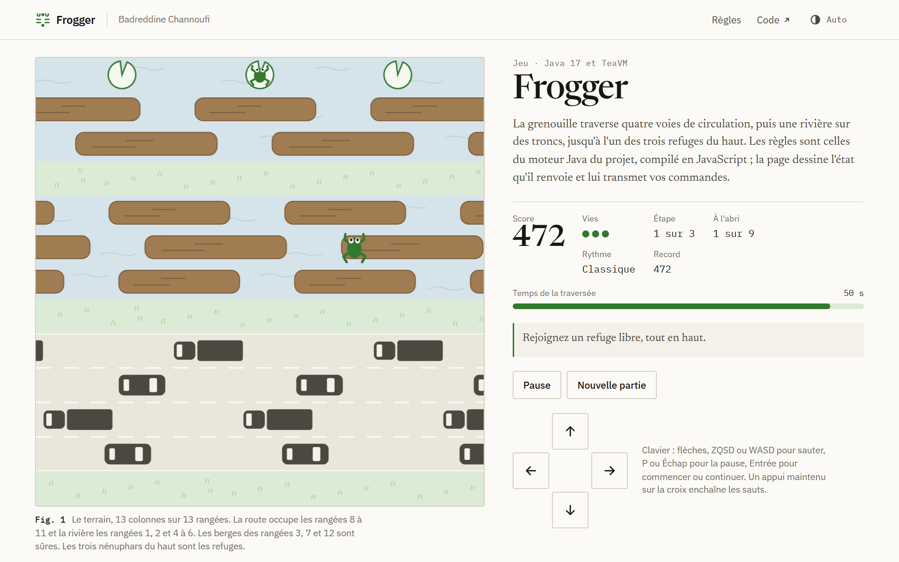
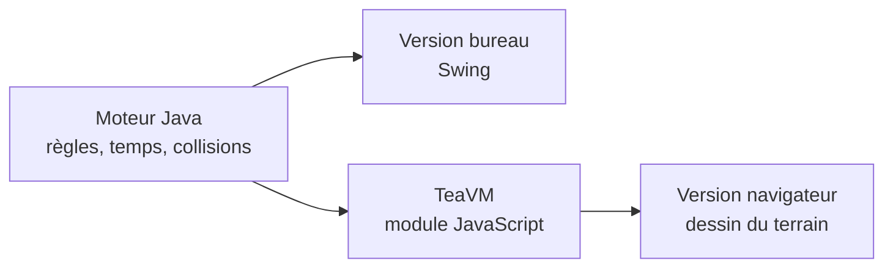

<p align="center">
  
</p>

<h1 align="center">Frogger</h1>

<p align="center">
  Un jeu de traversée en Java : la même logique fait tourner une fenêtre Swing<br>
  et la version navigateur, compilée en JavaScript avec TeaVM.
</p>

<p align="center">
  <a href="https://badreddine05.github.io/frogger/"><strong>Jouer dans le navigateur</strong></a>
  &nbsp;·&nbsp;
  <a href="docs/ENGINE.md">Le moteur</a>
  &nbsp;·&nbsp;
  <a href="https://badreddine05.github.io/">Portfolio</a>
</p>

<picture>
  <source media="(prefers-color-scheme: dark)" srcset=".github/readme/frogger-dark.png">
  
</picture>

## Le jeu

La grenouille part du bas d'un terrain de 13 cases sur 13. Elle doit traverser quatre voies de circulation, puis cinq lignes de rivière qu'on ne franchit qu'en sautant de tronc en tronc, et rejoindre l'un des trois refuges du haut avant la fin du temps. Remplir les trois refuges termine une étape. La partie est gagnée après neuf sauvetages répartis sur trois étapes, et perdue quand il ne reste plus de vie.

Chaque nouvelle rangée atteinte rapporte 10 points, une seule fois par traversée : les allers-retours ne rapportent rien. Un refuge vaut 200 points, plus 2 points par seconde restante, et une étape terminée en ajoute 500.

| Difficulté | Vies | Temps par traversée | Vitesse du trafic |
| --- | ---: | ---: | ---: |
| Balade | 5 | 70 s | × 0,72 |
| Classique | 3 | 55 s | × 1 |
| Express | 3 | 45 s | × 1,25 |

La vitesse augmente encore à chaque étape (× 1, × 1,16, puis × 1,32), et les véhicules se rapprochent.

## Commandes

- Clavier : les flèches, ZQSD ou WASD pour sauter, P ou Échap pour mettre en pause ou reprendre, Entrée pour l'action proposée (commencer, continuer, passer à l'étape suivante, rejouer).
- Écran tactile ou souris : une croix de direction à l'écran. Un appui fait un saut ; un appui maintenu en enchaîne plusieurs.
- Le jeu se met en pause tout seul quand l'onglet est masqué, quand la fenêtre perd le focus ou quand les règles sont ouvertes, et la reprise reste manuelle. Le meilleur score de chaque difficulté est gardé sur l'appareil.

## Comment c'est construit



Le moteur ne connaît ni l'écran ni l'horloge. Il avance par pas fixes de 20 ms, si bien qu'une même graine et une même suite d'actions redonnent toujours la même partie. Les deux interfaces se contentent de dessiner ce que le moteur expose et de lui transmettre les commandes.

Seize tests JUnit vérifient les règles : collisions, transport par un tronc, délai, refuges, score, progression. Trois tests Node exécutent le module JavaScript produit par TeaVM. Le premier rejoue 463 actions dans les trois difficultés et compare chaque état à celui de la JVM ; les deux autres vérifient qu'un saut ne fait pas avancer le temps et que la pause fige la partie.

## Lancer le projet

La version bureau ne demande qu'un JDK 17 ou plus récent :

```powershell
./scripts/run.ps1
```

Sous Linux ou macOS : `sh scripts/run.sh`. Le moteur, les tests et la version navigateur se construisent avec le Maven Wrapper fourni et Node.js 22.12 ou plus récent ; tout est détaillé dans [docs/BUILD.md](docs/BUILD.md).

## Histoire du projet

La première version date de novembre 2021 : une application Java Swing qui s'appuyait sur une bibliothèque fournie (`givenEnvironment.jar`). Ses trois commits, sous l'auteur `bjrc`, sont conservés tels quels. Elle avait plusieurs défauts : chaque déplacement faisait aussi avancer le trafic, la grenouille ne changeait pas de direction, et la victoire ou la défaite s'affichaient dans la console sans terminer la partie.

La version 2, en 2026, remplace la bibliothèque fournie par un moteur original et sépare les entrées, le temps et l'affichage. Elle ajoute les états de jeu, les refuges, le transport par les troncs et la progression. [docs/HISTORIQUE.md](docs/HISTORIQUE.md) détaille ces changements.

## Limites

- Le jeu est local et solo : pas de multijoueur, de serveur, de compte, de classement en ligne ni de sauvegarde de partie.
- Les collisions se calculent par rangée et par intervalle, sans détection au pixel près.
- L'équilibrage des difficultés n'a pas été testé auprès de joueurs.

## Licence et crédits

Le nouveau code de la version 2 est sous licence [MIT](LICENSE) ; elle ne change pas les droits attachés aux fichiers de 2021 ni à la bibliothèque fournie. Les notices de TeaVM et du Maven Wrapper sont dans [`docs/licenses/`](docs/licenses/), celles des polices de l'interface web dans [`web/public/licenses/`](web/public/licenses/).

Projet d'étude inspiré du jeu d'arcade du même nom, sans lien avec ses ayants droit : aucun sprite, musique ou logo commercial n'est repris. Première version par `bjrc` (2021) ; version 2 par [Badreddine Channoufi](https://badreddine05.github.io/), avec l'aide d'outils d'IA.

<details>
<summary>English summary</summary>

A crossing game written in Java. One deterministic engine runs both the Swing desktop window and the browser version, compiled to JavaScript with TeaVM. Sixteen JUnit tests check the rules, and parity tests replay 463 actions to compare the JavaScript module with the JVM, state by state.

</details>
