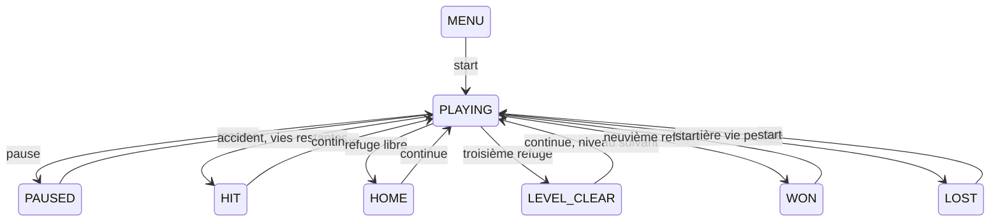

# Moteur de Frogger

La version 2 sépare les règles du temps réel et de l'affichage. Le même moteur Java s'exécute dans la JVM et dans le module JavaScript produit par TeaVM. Le navigateur dessine les valeurs exposées par le moteur ; il ne possède pas sa propre simulation.

## Organisation

| Composant | Responsabilité |
| --- | --- |
| `GameEngine` | États, entrées, temps, collisions, refuges, vies, score et progression |
| `Lane` | Voie périodique, géométrie des véhicules/troncs et vitesse |
| `Difficulty`, `Direction`, `GameState` | Valeurs admises par les règles |
| `GameSession` | Protocole de commandes, utilisé par le bridge et les replays |
| `Snapshot` | Sérialisation explicite du contrat JSON version 1 |
| `WebBridge` | Quatre exports TeaVM, sans logique de jeu supplémentaire |
| `desktop/Main` | Fenêtre Swing, boutons, clavier, focus, aide et boucle native |
| `desktop/BoardPainter` | Rendu vectoriel original, sans modification de l'état |

Le noyau n'importe aucune classe AWT, Swing, DOM ni bibliothèque de rendu. Une nouvelle interface peut utiliser le même protocole, sans modifier les règles. Le contrat frontend complet figure dans `FRONTEND_HANDOFF.md`.

## Temps et commandes

La simulation utilise des pas fixes de 20 ms. `advance` accumule les millisecondes reçues et exécute autant de pas entiers que nécessaire. Le résidu est conservé. Ainsi, une seconde reçue en un seul appel ou en cent appels de 10 ms produit le même état.

Un déplacement change la position et vérifie immédiatement son danger. Il ne fait avancer ni les voies ni le chronomètre. Les déplacements réussis sont espacés de 120 ms de temps simulé. Un saut bloqué par le bord ou un refuge indisponible n'avance pas le temps et ne coûte pas de vie.

L'adaptateur d'interface doit conserver les fractions de milliseconde entre deux frames et plafonner un retard visuel à 100 ms. Il met le moteur en pause quand la fenêtre perd le focus. Le noyau lui-même n'a pas d'horloge système, ce qui permet les tests et les replays.

## Terrain et collisions

Le terrain mesure 13 × 13 cases. Les coordonnées partent du coin supérieur gauche. La grenouille commence au centre de la rangée 12. Les rangées 3, 7 et 12 sont sûres ; les routes occupent les rangées 8 à 11 ; les rivières occupent les rangées 1, 2, 4, 5 et 6.

Chaque voie est une suite périodique d'objets de longueur et d'espacement constants. Une phase initiale est déterminée par la graine et le niveau. La phase évolue à vitesse constante ; la liste des objets visibles est calculée à partir de cette phase, sans accumulation d'objets ni apparition aléatoire par frame.

Sur la route, l'intervalle horizontal de la grenouille, de rayon 0,28 case, est comparé à celui des véhicules de sa rangée. Les collisions sont contrôlées après un saut et à chaque pas de simulation. À la vitesse maximale du jeu, un véhicule se déplace de moins de 0,05 case par pas, bien en dessous de sa longueur minimale ; une voiture ne peut donc pas traverser intégralement la grenouille entre deux contrôles.

Sur la rivière, le centre de la grenouille doit se trouver sur un tronc avec une marge intérieure de 0,1 case. Lors du pas suivant, le moteur lui applique la même translation que le tronc, puis vérifie à nouveau le support et les limites du terrain. Une sortie du centre au-delà du rayon de sécurité provoque une perte de vie. Il s'agit d'une collision par rangée et intervalle, pas d'une physique par pixels.

Les trois refuges ont leurs centres en colonnes 2,5 ; 6,5 ; 10,5. Un saut vers le haut est accepté dans une zone de 0,65 case autour d'un centre libre. Il est ajusté à ce centre. Un refuge déjà rempli ne peut être compté deux fois.

## Partie et progression

Les états d'attente figent le trafic et le temps. L'utilisateur continue explicitement après une vie perdue, une arrivée ou une étape complète. Les neuf arrivées réparties sur trois étapes gagnent la partie ; perdre toutes ses vies la termine. `start` réinitialise entièrement la partie.

| Difficulté | Vies | Temps par traversée | Multiplicateur de vitesse |
| --- | ---: | ---: | ---: |
| Balade | 5 | 70 s | 0,72 |
| Classique | 3 | 55 s | 1 |
| Express | 3 | 45 s | 1,25 |

La vitesse d'une étape est ensuite multipliée par 1, 1,16 ou 1,32. Les espaces entre véhicules sont réduits de 0,25 case par nouvelle étape. Les dimensions de collision restent identiques pour toutes les difficultés.

Le score récompense une nouvelle rangée atteinte à hauteur de 10 points, une seule fois par traversée ; les allers-retours ne rapportent rien. Un refuge vaut 200 points plus deux points par seconde entière restante. Une étape complète ajoute 500 points. Les points acquis restent après une vie perdue, et le prochain départ réinitialise le temps de traversée.

## Validation et limites

Les 16 tests JUnit contrôlent les entrées indépendantes du temps, l'intégration par pas fixes, la pause, les collisions, le transport par un tronc, la sortie latérale, le délai, les refuges uniques, le score sans aller-retour, la progression et la réinitialisation.

Trois tests Node exécutent le module réellement produit par TeaVM. Le test de parité compare chaque snapshot d'un replay de 463 actions avec la JVM, pour les trois difficultés et des graines comprenant les bornes des entiers signés. Seule une tolérance de 10⁻⁸ est admise pour les nombres flottants ; chaînes, clés, états et tableaux sont comparés exactement. Ces tests ne remplacent pas l'exercice du frontend dans un navigateur.

Les tests de progression utilisent des fixtures de position et de voies dans le code de test, sans ajouter de commande de téléportation à l'API publique. Ils vérifient les règles de fin de niveau, sans prétendre qu'un joueur a parcouru les neuf traversées complètes. Les choix de difficulté restent à apprécier en jouant ; aucun score d'équilibrage ou test utilisateur n'est inventé.

Cette version est locale et solo : pas de multijoueur, de serveur, de compte, de classement distant ni de sauvegarde de partie. La simulation n'est pas un clone exact des règles d'une borne commerciale.
